<p align="center">
  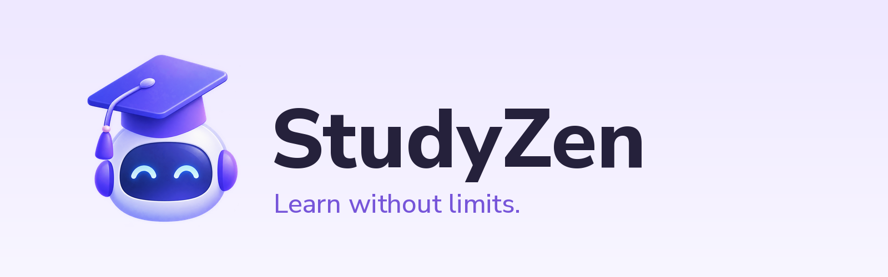
</p>

# StudyZen - Kotlin Multiplatform Contest, KotlinConf 2027

## Overview

**StudyZen** is an open-source AI study planner built with Kotlin Multiplatform and Compose Multiplatform. Students create a **Study Space** for a subject or exam, and StudyZen turns it into a plan, a learning path, lessons, quizzes and study sessions, all in one place.

One shared codebase (about 94% of the app code) runs on **Android, Desktop (Windows / macOS / Linux), Web (Wasm and JS) and iOS**.

- Essay: [ESSAY.md](ESSAY.md)
- Demo video: [watch it here](#demo-video)
- License: [MIT](LICENSE)

## Download and try

| Platform | Get it |
|---|---|
| **Web (launch in your browser)** | **https://emmanuelfred.github.io/studyzen/** |
| Android | [StudyZen-android.apk](https://github.com/emmanuelfred/studyzen/releases/latest/download/StudyZen-android.apk) (allow "install unknown apps") |
| Windows | [StudyZen-windows.msi](https://github.com/emmanuelfred/studyzen/releases/latest/download/StudyZen-windows.msi) |
| macOS | [StudyZen-macos.dmg](https://github.com/emmanuelfred/studyzen/releases/latest/download/StudyZen-macos.dmg) |
| Linux | [StudyZen-linux.deb](https://github.com/emmanuelfred/studyzen/releases/latest/download/StudyZen-linux.deb) |

All builds are on the [Releases page](https://github.com/emmanuelfred/studyzen/releases). Open the app and choose **Try without an account** to explore right away.

## Technologies

### Core platform and languages
- **Kotlin Multiplatform** - shared logic and UI for every target
- **Kotlin 2.4** with coroutines and kotlinx.serialization
- **Swift** - only the small iOS host

### UI framework
- **Compose Multiplatform 1.12** - one UI for Android, Desktop, Web and iOS
- Custom brand theme (lavender and violet palette, Nunito Sans)

### Architecture and state management
- Feature-based packages (`feature/*`) over pure domain logic (`domain/*`) and a data layer (`data/*`)
- Lightweight sealed `Screen` + `AppNavigator` navigation that behaves the same on all targets
- `expect/actual` only where the operating system is involved (alarms, camera, storage)

### Backend and networking
- **Ktor Client** - multiplatform HTTP client
- **Node.js** (Express) backend for accounts, e-mail verification and cloud sync. It is **hosted for you**, so there is nothing to install or configure to run the app.
- **Guest mode** - the whole app also works offline without an account

### Data storage and persistence
- multiplatform-settings for on-device storage on every platform
- AI keys are stored **on the device only**

### AI
- **Bring-your-own-key** support for Gemini, Groq and OpenRouter
- Wikipedia results are real retrieved text; YouTube and web results are plainly labelled search links; model output is labelled AI-generated

## Features

- **Study wizard** - subject, goal, level, deadline and daily time produce a plan
- **Learning path and lessons** - ordered lessons with progress
- **Tools inside every lesson** - Ask AI / Scan, Dictionary, Calculator, Research and Notes. Each keeps a **history**, so you can reopen an earlier chat, search or note instead of starting a new one
- **Quizzes** with scoring and honest, clearly labelled feedback
- **Start studying** - one screen lists every open Study Space, then a session timer and summary
- **Progress** - streaks, time studied, completed lessons, quiz results
- **Reminders** - real alarm reminders on Android
- **Account and sync** - sign up, e-mail verification, password reset, cloud sync
- **Guest mode** - tap *Try without an account* to explore with sample data

### Feature support per platform

The UI is shared everywhere. A few features need operating-system APIs and are only available where the platform provides them.

| Capability | Android | Desktop | Web | iOS |
|---|:-:|:-:|:-:|:-:|
| Study spaces, plans, lessons, quizzes, progress | yes | yes | yes | yes |
| AI tools, Dictionary, Calculator, Research | yes | yes | yes | yes |
| Guest mode and sample data | yes | yes | yes | yes |
| Account and cloud sync | yes | yes | yes | yes |
| Alarm-style reminders | yes | - | - | - |
| Photo scan (camera or gallery) | yes | choose a file (no camera) | text only | text only |
| Voice notes | yes | yes | - | - |
| Google sign-in | yes | yes (opens your browser) | - | - |

### Verified on

| Target | Date checked | Result |
|---|---|---|
| Android phone | 2026-10-22 | Runs on a physical phone (see screenshots and demo video) |
| Desktop | _fill in_ | _fill in_ |
| Web (Wasm) | 2026-10-23 | Production build succeeds; browser run: _fill in_ |
| Web (JS) | _fill in_ | _fill in_ |
| iOS simulator | _fill in or "not tested"_ | _fill in_ |

## Prerequisites

- **JDK 17 or newer** (21 recommended)
- **Android Studio** (latest stable) for Android
- **Xcode 15+ on macOS** for iOS only
- A recent Chrome, Edge or Firefox for the web targets

## Setup and installation

```bash
git clone https://github.com/emmanuelfred/studyzen.git
cd studyzen
```

No API keys, database or server setup are needed. On Windows use `gradlew.bat` instead of `./gradlew`.

## Running the app

### Android
Open the project in Android Studio, select the `androidApp` configuration, choose an emulator or a phone, and press Run. Or:
```bash
./gradlew :androidApp:installDebug
```

### Desktop (Windows, macOS, Linux)
```bash
./gradlew :desktopApp:run
```

### Web
```bash
./gradlew :webApp:wasmJsBrowserDevelopmentRun   # Wasm (modern browsers)
./gradlew :webApp:jsBrowserDevelopmentRun       # JS (older browsers)
```
Open the `http://localhost:8080` address Gradle prints.

### iOS
1. On a Mac, open `iosApp/iosApp.xcodeproj` in Xcode.
2. Select an iPhone simulator.
3. Press Run. Xcode builds the shared Kotlin framework (`Shared`) through Gradle automatically.

## Key features and how to try them

### Try the app without an account
On the first screens choose **Log in -> Try without an account**. Sample study spaces are loaded so every screen has content. Create an account later from **Profile -> Sign in or create an account**.

### Create a Study Space
Home -> **+** -> follow the wizard. Open the space to see the learning path.

### Use the lesson tools
Open a lesson and tap Ask AI, Dictionary, Calculator, Research or Notes. Your previous items are listed first; pick one to continue or choose **New**.

### Turn on AI
Profile -> AI settings -> choose Gemini, Groq or OpenRouter and paste your own key. The key never leaves your device. Everything else works without it.

### Study and track progress
**Start studying** shows all open Study Spaces. Pick one, run a session, then see the summary and the Progress tab.

## Project structure

```
studyzen/
├── shared/         Kotlin Multiplatform module: all UI, domain logic, data, AI, sync
│   └── src/
│       ├── commonMain/   ~16,000 lines used by every platform
│       ├── commonTest/   unit tests
│       └── androidMain, jvmMain, iosMain, jsMain, wasmJsMain   small expect/actual files
├── androidApp/     Android entry point, alarms, camera, voice, Google sign-in
├── desktopApp/     Compose Desktop window
├── webApp/         Browser entry point (Wasm and JS)
├── iosApp/         Xcode project hosting the shared UI
└── docs/           Logo, screenshots, video notes
```

### Shared code evidence
```bash
bash scripts/shared-code-ratio.sh
```
```
Shared (commonMain):             16261 lines
Platform entry points and APIs:  891 lines
Shared share of app code:        94%
```

### Tests
```bash
./gradlew :shared:jvmTest
```

## Screenshots

### Android

| Home | Plan | Quick actions |
|:-:|:-:|:-:|
| 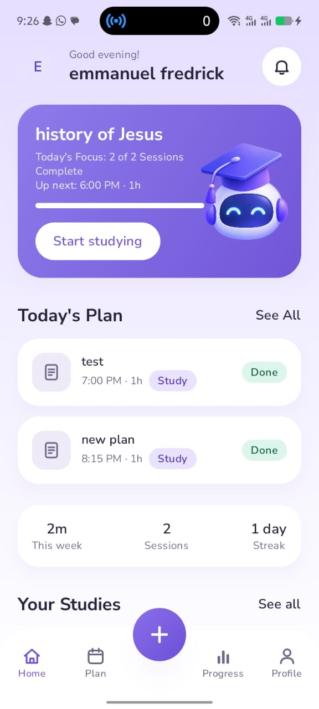 | 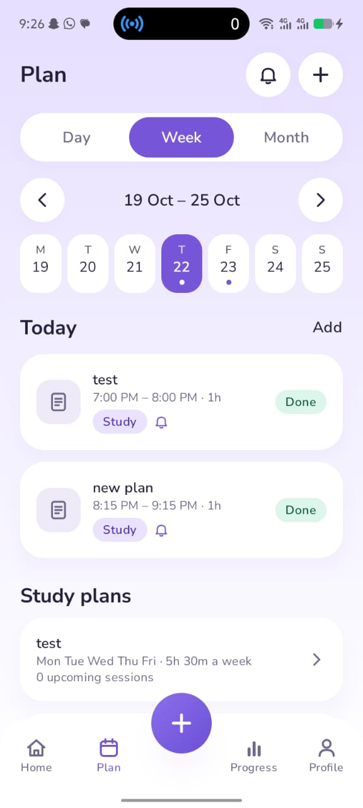 | 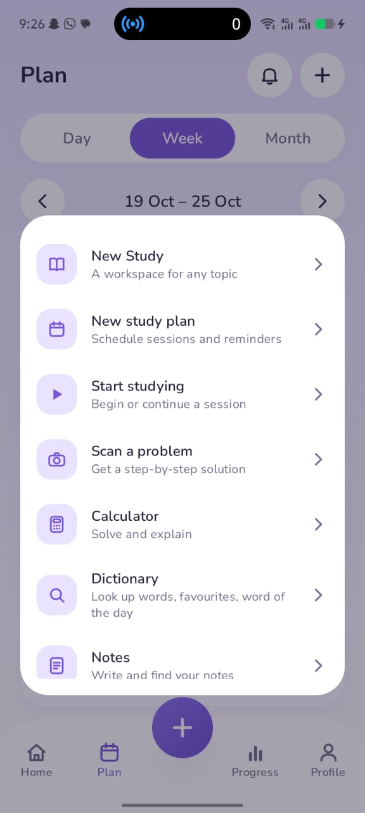 |

| Progress | Subject breakdown | Your studies |
|:-:|:-:|:-:|
| 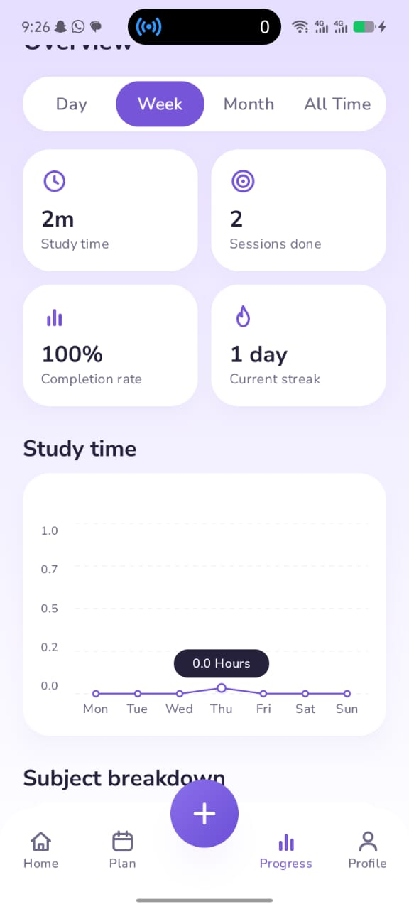 | 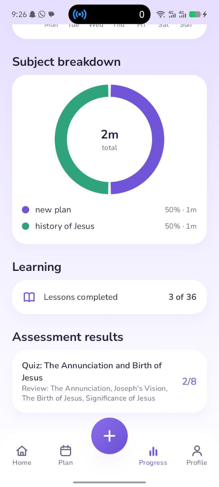 | 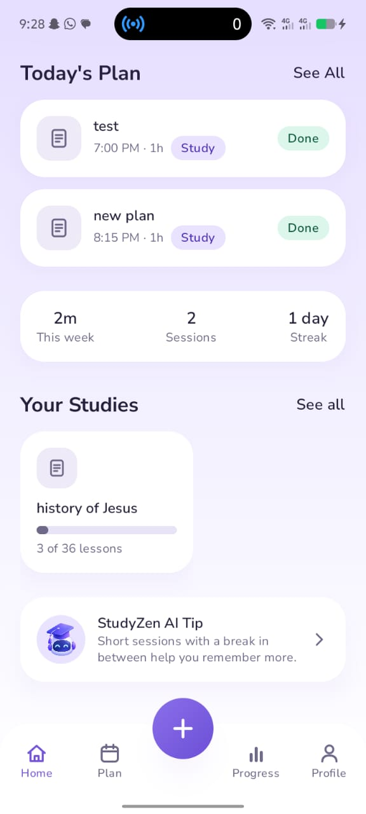 |

| Backup and sync | Alarm reminders |
|:-:|:-:|
| 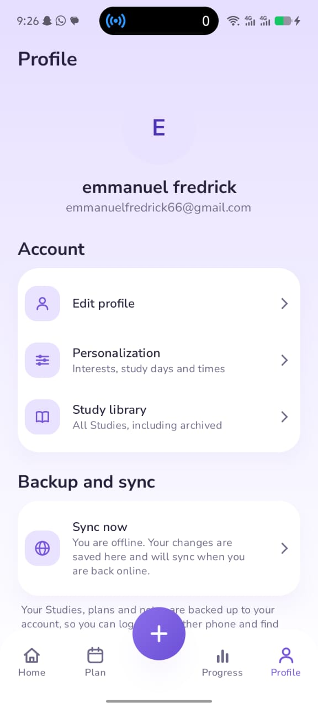 | 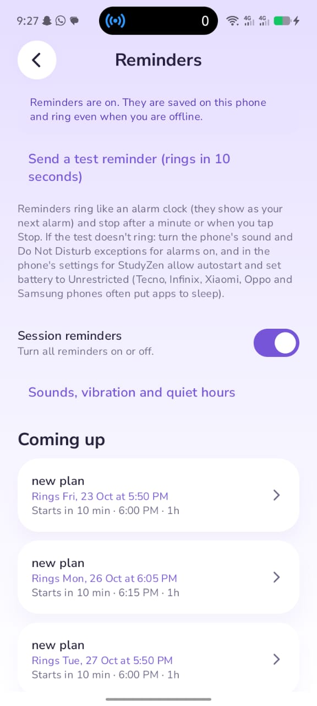 |

### Same app on Desktop

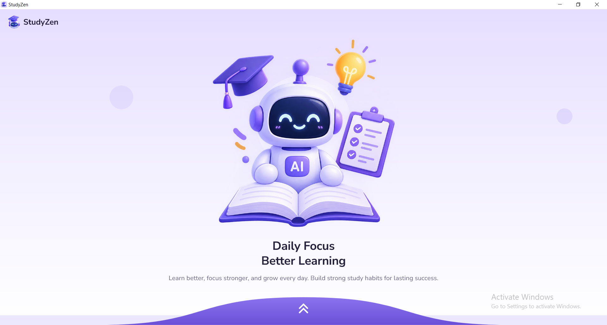

## Demo video

[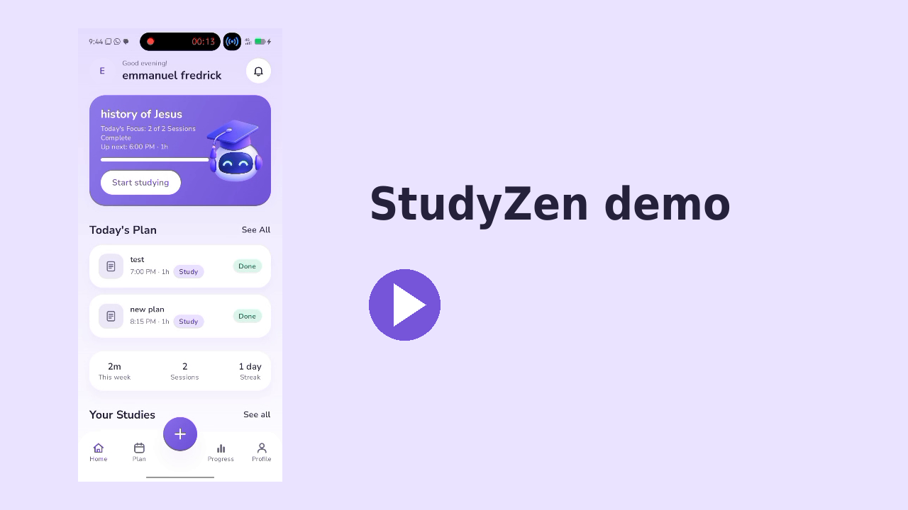](docs/video/mobile_demo.mp4)

- **Android demo** (1 min 22 s): [docs/video/mobile_demo.mp4](docs/video/mobile_demo.mp4)
<!-- Add after recording: - **Desktop demo**: [docs/video/desktop_demo.mp4](docs/video/desktop_demo.mp4) -->

## Troubleshooting

- **Gradle sync fails:** use JDK 17+ (File -> Settings -> Build Tools -> Gradle -> Gradle JDK).
- **Web page is blank:** use the Wasm task in a current Chrome/Edge, or the JS task in any other browser.
- **iOS build fails:** run `./gradlew :shared:linkDebugFrameworkIosSimulatorArm64` once, then rebuild in Xcode.
- **Sign-in or sync error:** you are offline or the hosted service is busy. Use **Try without an account**.
- **AI answers do not appear:** add your own key under Profile -> AI settings.

## Contest notes

Created as an individual entry for the Kotlin Multiplatform Contest, KotlinConf 2027. AI coding assistance was used while building the project; see [ESSAY.md](ESSAY.md).

## License

[MIT](LICENSE)
